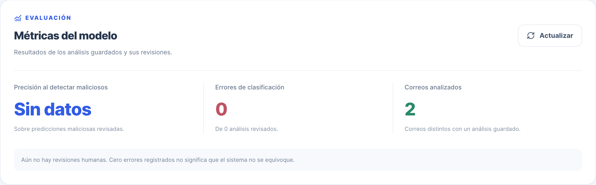
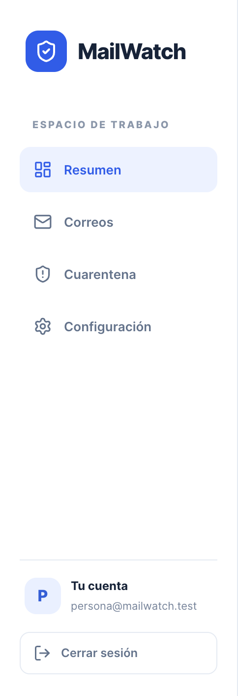

# CP-US10-01 — Visualizar métricas disponibles

| | |
|---|---|
| **Identificador** | CP-US10-01 |
| **Issue del caso** | [#37](https://github.com/msancheza1/MailWatch_P2/issues/37) |
| **Historia relacionada** | [US-10 — Visualización de métricas del modelo (#12)](https://github.com/msancheza1/MailWatch_P2/issues/12) |
| **Responsable** | Juan Esteban Martínez (JuanMartinez1906) |
| **Fecha de ejecución** | 8 de noviembre de 2026 |
| **Versión probada** | `main` en `9f0a09a` («Sprint 2») |
| **Entorno** | PostgreSQL 16.15 en Docker (`:5433`), backend en `:3000`, frontend en `:5173`, Chrome |

## 1. Objetivo

La historia dice: *«Como administrador quiero consultar métricas del sistema para evaluar
su funcionamiento»*, y nombra tres: **precisión**, **errores** y **cantidad de correos
analizados**.

El caso comprueba dos cosas distintas, y conviene no mezclarlas:

1. Que el administrador **vea** las tres métricas y que quien no es administrador **no**
   las vea.
2. Que los números **signifiquen lo que dicen**. Una pantalla que muestra «0 errores»
   porque nadie ha revisado nada no está informando: está tranquilizando.

## 2. Precondiciones

- [ ] PostgreSQL levantado y migraciones aplicadas, incluida `004_model_metrics.sql`, que
      es la que añade `users.is_admin` y `analysis_results.expected_risk_level`.
- [ ] Backend en `:3000` y frontend en `:5173`.
- [ ] Una cuenta **administradora** y otra **sin** permisos.

> **Atención.** No hay forma soportada de crear un administrador: `npm run user:create`
> no escribe `is_admin` y no existe ninguna ruta que lo haga. Comprobado al ejecutar: las
> dos cuentas se crearon con `is_admin = f` y hubo que marcar una a mano en la base para
> poder seguir. Está registrado como **hallazgo H-02**.
>
> ```sql
> UPDATE users SET is_admin = TRUE WHERE email = 'admin@mailwatch.test';
> ```

## 3. Datos de prueba

| Dato | Valor |
|---|---|
| Cuenta administradora | `admin@mailwatch.test` |
| Cuenta sin permisos | `persona@mailwatch.test` |
| Correos | Los cinco de `database/seeds/emails_dataset.csv` |
| Correo que clasifica como malicioso | `id 1` · `security@fakebank.com` · «Verify account» |

## 4. Casos

| # | Flujo | Resultado | Evidencia |
|---|---|---|---|
| 4.1 | Exitoso — el administrador consulta las métricas | ✅ Aprobado | interfaz + API + suite |
| 4.2 | Alternativo — cuenta sin permisos | ✅ Aprobado | interfaz + API + suite |
| 4.3 | Alternativo — sin sesión iniciada | ✅ Aprobado | API + suite |
| 4.4 | Cálculo — precisión y errores sobre lo revisado | ✅ Aprobado | suite automatizada |
| 4.5 | Cálculo — «correos analizados» no cuenta repeticiones | ✅ Aprobado | suite automatizada |
| 4.6 | Límite — la precisión nunca salía de «Sin datos» | ⚠️ Hallazgo **H-01**, corregido después | suite automatizada |

---

### 4.1 · Flujo exitoso — el administrador consulta las métricas

**Pasos**

1. Iniciar sesión con la cuenta administradora.
2. Abrir el panel. La sección **«Métricas del modelo»** aparece bajo las tarjetas de resumen.
3. Analizar el correo `id 1` desde la bandeja.
4. Pulsar **«Actualizar»** en la sección de métricas.

**Resultado esperado**

- Se ven las tres métricas de la historia: «Precisión al detectar maliciosos», «Errores de
  clasificación» y «Correos analizados».
- «Correos analizados» pasa de 0 a 1.
- Al pie aparece la nota que explica sobre cuántos análisis revisados se calcula.

**Resultado obtenido** — La sección aparece con las tres tarjetas y la entrada
«Métricas» sale en la barra lateral. La API responde:

```
$ curl -s http://localhost:3000/dashboard/model-metrics -H "Authorization: Bearer <admin>"
{"emailsAnalyzed":2,"reviewedAnalyses":0,"classificationErrors":0,"precision":null}
HTTP 200
```



*Captura tomada durante la ejecución del caso, antes de corregir H-01: de ahí el «Sin datos».*

**Estado:** ✅ **Aprobado** — la pantalla se ve y responde. Que la precisión diga «Sin
datos» es el hallazgo **H-01**, no un fallo de este flujo.

---

### 4.2 · Flujo alternativo — cuenta sin permisos de administrador

**Pasos**

1. Iniciar sesión con `persona@mailwatch.test`.
2. Abrir el panel.

**Resultado esperado** — La sección de métricas **no se muestra**, y la entrada «Métricas»
no aparece en la barra lateral. La petición responde `403`.

**Resultado obtenido** — `403 Forbidden` con «Acceso exclusivo para administradores.».
En la interfaz desaparecen las dos cosas: la sección de métricas y el enlace «Métricas»
del menú. El resto del panel queda idéntico.

```
{"message":"Acceso exclusivo para administradores.","error":"Forbidden","statusCode":403}
HTTP 403
```



`ModelMetrics.tsx` devuelve `null` ante un 403, de modo que el panel desaparece entero en
vez de enseñar un error. Es el comportamiento correcto: un mensaje de «no tienes permiso»
le confirmaría a cualquiera que esa pantalla existe.

**Estado:** ✅ **Aprobado**

---

### 4.3 · Flujo alternativo — sin sesión iniciada

**Pasos** — Pedir `GET /dashboard/model-metrics` sin cabecera de autorización.

**Resultado esperado** — `401`, no `403`. La diferencia importa: `401` es «no sé quién
eres», `403` es «sé quién eres y no puedes».

**Resultado obtenido** —

```
{"message":"Inicia sesión para continuar.","error":"Unauthorized","statusCode":401}
HTTP 401
```

**Estado:** ✅ **Aprobado**

---

### 4.4 · Cálculo — precisión y errores sobre análisis revisados

La precisión que calcula `DashboardService.getModelMetrics()` es la de **la clase
maliciosa**: de todas las veces que el sistema dijo «malicioso» y alguien lo verificó,
cuántas acertó. No es «porcentaje de aciertos del sistema».

**Datos**

| Análisis | El sistema dijo | La persona verificó |
|---|---|---|
| 1 | Malicioso | Malicioso |
| 2 | Malicioso | Malicioso |
| 3 | Malicioso | Seguro |
| 4 | Sospechoso | Seguro |

**Resultado esperado** — Precisión **66,67 %** (2 de 3 predicciones maliciosas revisadas),
**2 errores** de clasificación (los análisis 3 y 4) sobre **4 análisis revisados**.

**Resultado obtenido** — `precision: 66.67`, `classificationErrors: 2`,
`reviewedAnalyses: 4`.

**Estado:** ✅ **Aprobado**

> El análisis 4 cuenta como error pero no entra en la precisión, porque la precisión solo
> mira las predicciones maliciosas. Son dos preguntas distintas y la pantalla las muestra
> como dos tarjetas distintas, que es lo correcto.

---

### 4.5 · Cálculo — «correos analizados» no cuenta repeticiones

**Pasos** — Analizar **dos veces el mismo correo** y consultar las métricas.

**Resultado esperado** — «Correos analizados» = **1**, aunque haya dos registros en
`analysis_results`.

**Resultado obtenido** — `emailsAnalyzed: 1` con dos filas en `analysis_results`. La
consulta usa `COUNT(DISTINCT email_id)`.

**Estado:** ✅ **Aprobado**

> No es un detalle menor: la tarjeta «Análisis de riesgo alto» del resumen **sí** cuenta
> repeticiones —su propia descripción lo advierte—, así que las dos cifras pueden no
> cuadrar sin que ninguna esté mal.

---

### 4.6 · Límite — la precisión nunca sale de «Sin datos»

**Pasos**

1. Analizar correos desde la aplicación, los que sean.
2. Marcar uno como **«Marcar como seguro»** (retroalimentación de US-08) para decirle al
   sistema que se equivocó.
3. Consultar las métricas.

**Resultado esperado** *(según la historia)* — Que la precisión y los errores reflejen algo.

**Resultado obtenido** — Precisión **«Sin datos»** y **0 errores**, siempre. Ninguna ruta
de la aplicación escribe `expected_risk_level`, y la corrección del usuario se guarda en
`email_feedback`, que estas métricas no consultan.

**Estado:** ⚠️ **Aprobado con hallazgo** — la pantalla se comportaba como estaba
programada; lo que fallaba es que dos de las tres métricas que pide la historia no se
podían alimentar desde el producto.

**Corregido** por Mejia1406 en el commit `f114c0f`. `getModelMetrics()` ya no exige que
alguien haya escrito `expected_risk_level`: deriva la revisión humana de la
retroalimentación de US-08, que es la que el producto sí recoge. La columna explícita se
conserva y tiene prioridad sobre la valoración, para cuando exista una revisión formal.
Ver **H-01** en la sección 6.

## 5. Ejecución automatizada

Las comprobaciones de arriba están automatizadas sobre las rutas reales, con el esquema
real de las migraciones y PGlite como base aislada —el mismo método de las suites de
US-08 y US-13—:

```bash
cd backend && npm run test:metricas
```

`backend/test/model-metrics.integration.mjs` · **13 de 13 aprobadas**.

Los flujos 4.1, 4.2 y 4.3 se ejecutaron **además** a mano sobre la aplicación corriendo,
con PostgreSQL en Docker y las dos cuentas reales. Los resultados coinciden con los de la
suite.

Las dos pruebas que documentaban H-01 se llamaban `LÍMITE:` y estaban escritas para
fallar el día en que el hallazgo se corrigiera. Ese día llegó: se invirtieron y hoy
comprueban lo contrario, que la valoración del usuario sí alimenta las métricas. El
último bloque de la suite cubre las dos fuentes de revisión, el cambio de opinión, la
prioridad de la revisión explícita y que reanalizar un correo no arrastre la revisión
anterior.

## 6. Hallazgos

| ID | Descripción | Severidad | Afecta |
|---|---|---|---|
| **H-01** | ~~Nada en la aplicación escribe `expected_risk_level`, así que «Precisión» siempre dice «Sin datos» y «Errores de clasificación» siempre es 0.~~ **Corregido** por Mejia1406 en `f114c0f`: las métricas derivan la revisión humana de la retroalimentación de US-08. Issue [#57](https://github.com/msancheza1/MailWatch_P2/issues/57). | **Alta** | US-10 |
| **H-02** | No hay forma soportada de crear un administrador: `user:create` no escribe `is_admin` y no existe ruta que lo haga. La historia es «como administrador» y el producto no sabe fabricar uno. | **Alta** | US-10, US-13 |
| **H-03** | «Análisis de riesgo alto» (resumen) cuenta análisis repetidos y «Correos analizados» (métricas) cuenta correos distintos. Las dos cifras pueden no cuadrar y nada en pantalla lo explica. | Media | US-10 |

**Cómo se corrigió H-01.** La retroalimentación de US-08 ya guardaba el dato que faltaba:
qué clasificó el sistema y qué dijo la persona. La consulta de métricas lo **deriva**, en
vez de copiarlo a `expected_risk_level` al registrar el reporte:

```sql
COALESCE(
  a.expected_risk_level,              -- revisión explícita, si existiera
  CASE latest.category
    WHEN 'Safe' THEN 'LOW'
    WHEN 'Malicious' THEN 'HIGH'
  END                                 -- la valoración más reciente de ese análisis
)
```

Derivarlo tiene dos ventajas sobre copiarlo. Copiar obligaría a elegir un ganador cuando
dos usuarios valoran el mismo análisis, y esa decisión quedaría congelada en la base sin
poder revisarse. Y copiar exigiría modificar `FeedbackService`, que pertenece a otra
historia ya entregada y probada; derivando, el único archivo que cambia es el que tenía
el defecto.

El usuario solo dispone de dos botones, de modo que su veredicto es binario: «Safe»
equivale a LOW y «Malicious» a HIGH. MEDIUM nunca aparece como valor esperado porque
nadie puede expresarlo, no porque se descarte.

La corrección llegó sin pruebas. Las trece de la sección 5 la verifican: se escribieron
contra el comportamiento esperado, no contra la implementación, y pasan sobre ella sin
cambios.

## 7. Qué falta

- [x] Ejecución visual con la aplicación corriendo y capturas, en `docs/evidencia/`.
- [x] H-01 corregido y verificado con pruebas; issue [#57](https://github.com/msancheza1/MailWatch_P2/issues/57) por cerrar al mezclar.
- [ ] Repetir la captura de la sección 4.1 con métricas reales, ahora que la precisión sí tiene datos.
- [ ] Decidir si se registra H-02 como issue.
- [ ] Subir el caso y las capturas a la wiki, en el informe de casos de prueba.
- [ ] Decidir en la retrospectiva si US-10 se da por terminada con dos métricas vacías.
