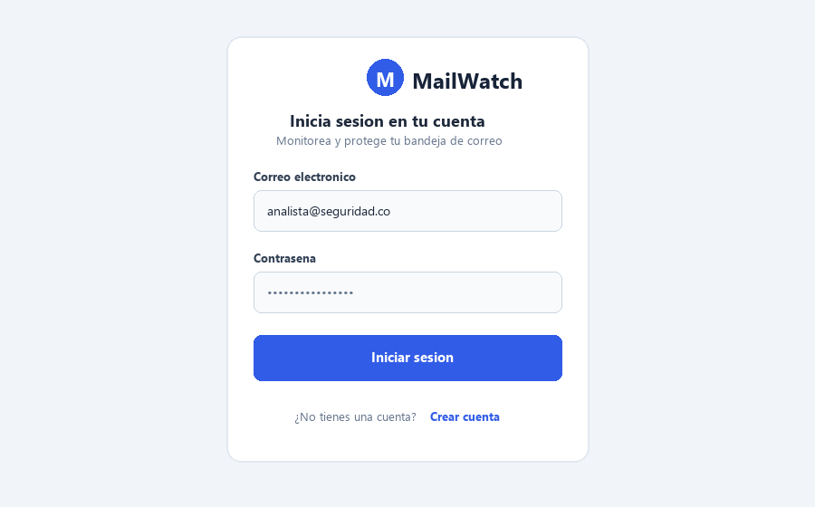
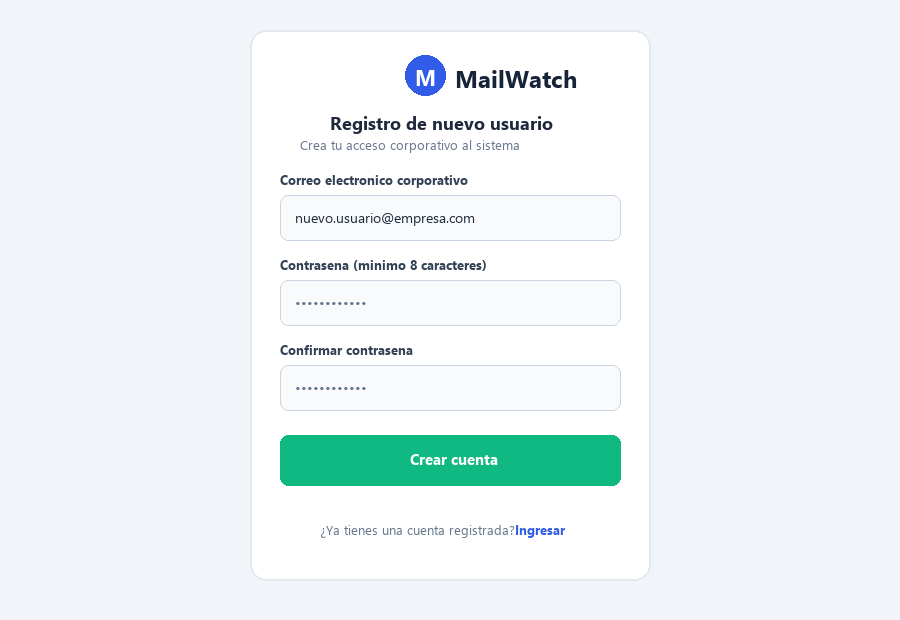
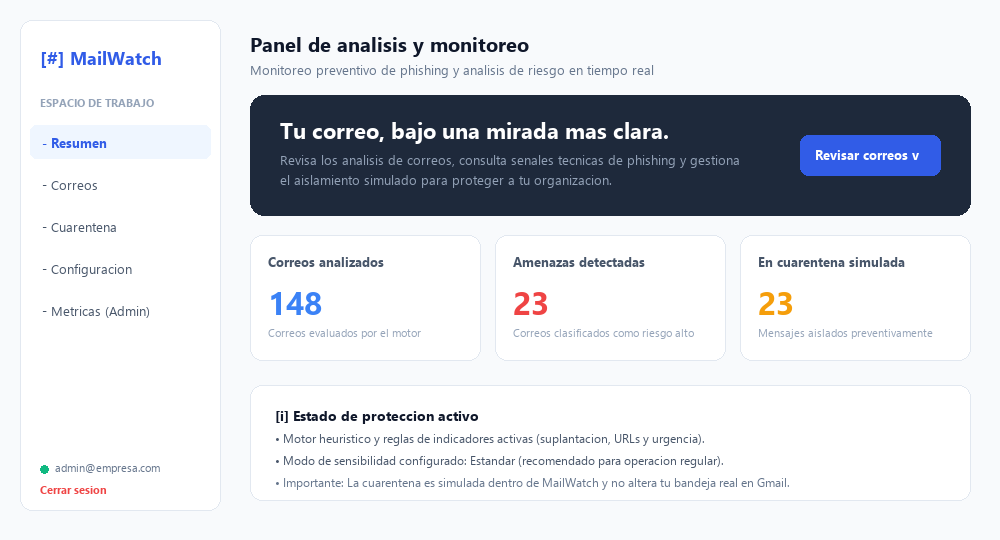
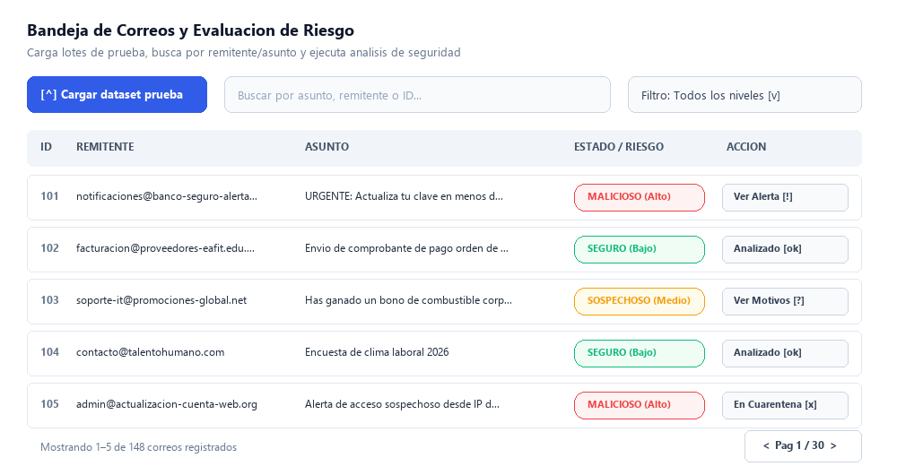
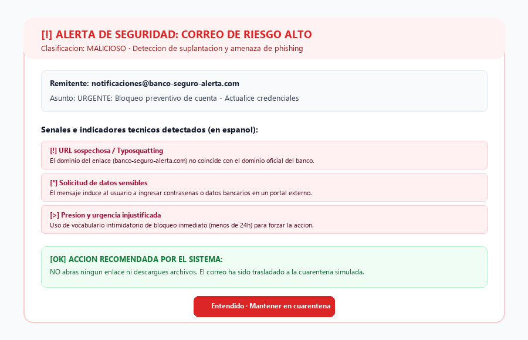
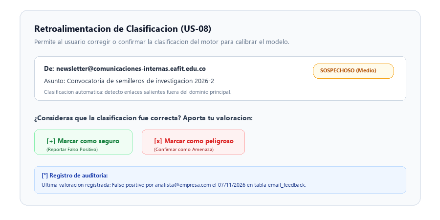
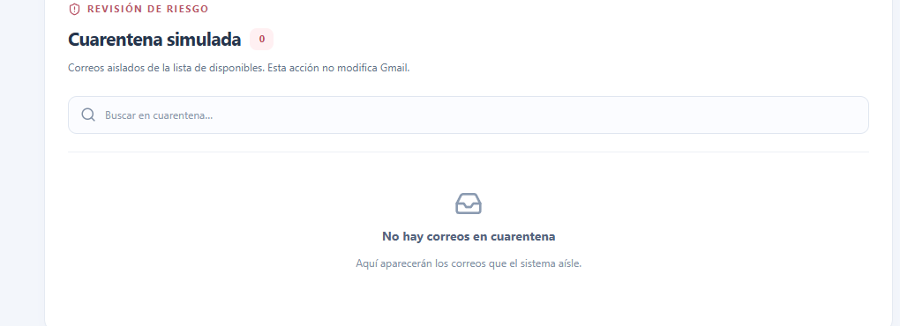
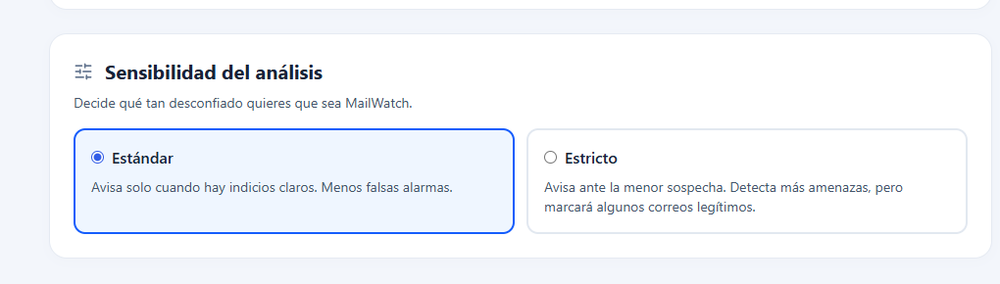
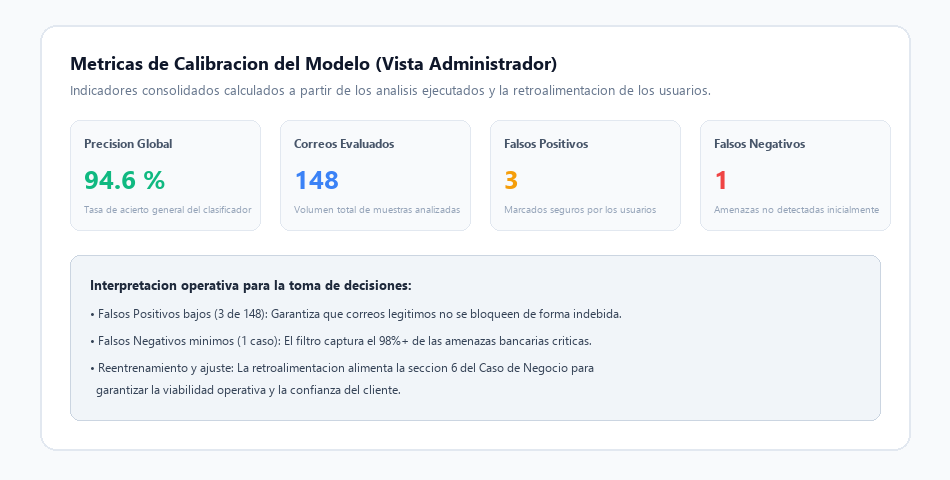

# Manual de Usuario — MailWatch

**Sistema de Monitoreo Preventivo y Análisis de Correos**  
*Documento de Entrega Final — Sprint 3*  
*Proyecto Integrador 2 — Universidad EAFIT*

---

## 1. Introducción y Propósito del Sistema

**MailWatch** es una plataforma diseñada para proteger a los usuarios frente a amenazas transmitidas por correo electrónico, tales como ataques de **phishing**, suplantación de identidad corporativa y enlaces a sitios fraudulentos. 

El objetivo principal de MailWatch es dotar a cualquier persona en la organización —sin importar si tiene o no conocimientos técnicos en ciberseguridad— de herramientas comprensibles para **tomar decisiones seguras**: saber si un correo se puede abrir con confianza, si debe ser tratado con cautela o si debe ser aislado de inmediato para evitar incidentes de seguridad.

> **Importante para el cliente:**  
> La cuarentena de correos es una funcionalidad de **aislamiento preventivo simulado dentro de la aplicación**. MailWatch no modifica, reenvía ni elimina correos directamente de su bandeja física en proveedores externos como Gmail o Microsoft 365, protegiendo en todo momento la integridad de su cuenta real.

---

## 2. Requisitos Previos y Acceso

Para utilizar MailWatch únicamente requiere:
* Un navegador web moderno (Google Chrome, Microsoft Edge, Mozilla Firefox o Safari).
* Conexión a la red local o a la dirección pública en la nube asignada por el equipo de administración.
* Una cuenta de correo electrónico corporativo registrada.

---

## 3. Módulo de Autenticación y Cuentas de Usuario

### 3.1 Inicio de Sesión
1. Abra el enlace de MailWatch en su navegador.
2. Ingrese su **Correo electrónico** corporativo y su **Contraseña**.
3. Haga clic en el botón azul **Iniciar sesión**.
4. Si las credenciales son válidas, ingresará automáticamente a su panel principal.

---

### 3.2 Registro de Nuevo Usuario (US-13)
Si es un usuario nuevo o se incorpora por primera vez al sistema:
1. En la parte inferior de la pantalla de inicio de sesión, haga clic en el enlace **Crear cuenta**.
2. Complete los campos requeridos:
   * **Correo electrónico corporativo:** Su dirección válida de correo (el sistema normaliza automáticamente minúsculas y elimina espacios).
   * **Contraseña:** Debe contar con un mínimo de **8 caracteres** para garantizar la seguridad de su cuenta.
   * **Confirmar contraseña:** Debe coincidir exactamente con la contraseña digitada.
3. Haga clic en el botón verde **Crear cuenta**.
4. Al confirmarse el registro exitoso, el sistema lo redireccionará a la pantalla de acceso con su correo ya diligenciado para iniciar sesión.

---

## 4. Panel de Control Principal (Dashboard)

Al ingresar a MailWatch, se presenta el panel general con el resumen del estado de protección de su cuenta.

### Elementos del Panel:
1. **Menú Lateral de Navegación:**
   * **Resumen:** Regresa a la vista general de métricas.
   * **Correos:** Desplaza la vista a la bandeja de trabajo y análisis.
   * **Cuarentena:** Acceso rápido a los correos aislados.
   * **Configuración:** Selector de sensibilidad del motor heurístico.
   * **Métricas (Admin):** Módulo de auditoría técnica exclusivo para administradores.
   * **Usuario y Cierre de Sesión:** Muestra la cuenta activa y permite finalizar la sesión de manera segura.
2. **Tarjetas de Estadísticas en Tiempo Real:**
   * **Correos analizados (Azul):** Cantidad total de correos que han sido procesados por el motor de análisis.
   * **Amenazas detectadas (Rojo):** Mensajes clasificados en nivel de riesgo alto (*Malicioso*).
   * **En cuarentena simulada (Amarillo):** Mensajes apartados preventivamente para evitar clics accidentales.

---

## 5. Bandeja de Trabajo y Análisis de Correos

La sección de correos permite revisar los mensajes disponibles, realizar búsquedas específicas y solicitar la evaluación de riesgo bajo demanda.

### Pasos para Gestionar los Correos:
1. **Cargar dataset de prueba:**
   * Pulse el botón azul **Cargar dataset de prueba** para incorporar el lote de mensajes de prueba etiquetados.
   * *Nota:* Cada pulsación agrega una copia del dataset; se sugiere cargarlo una sola vez al inicio de la jornada.
2. **Buscar correos específicos:**
   * Utilice la barra de búsqueda superior para filtrar instantáneamente por **nombre del remitente**, **asunto** o **número de ID**.
3. **Filtrar por nivel de riesgo:**
   * Despliegue el selector de filtros para visualizar únicamente correos:
     * *Todos los niveles*
     * *Pendientes por analizar*
     * *Seguro (Riesgo bajo)*
     * *Sospechoso (Riesgo medio)*
     * *Malicioso (Riesgo alto)*
4. **Solicitar análisis:**
   * En aquellos correos cuyo estado sea **Sin analizar**, haga clic en el botón **Analizar**. En menos de un segundo, el sistema evaluará el mensaje y mostrará su categoría correspondiente.

---

## 6. Interpretación de Alertas y Señales de Phishing (US-09)

Cuando el motor de análisis identifica un correo peligroso, despliega una **Alerta de Seguridad de Riesgo Alto** diseñada para evitar que el usuario tome acciones riesgosas.

### ¿Cómo interpretar la información?
* **Clasificación y Nivel de Riesgo:** Indica claramente si el correo es `MALICIOSO · Riesgo alto`.
* **Señales e Indicadores Técnicos en Español:**
  * **URL sospechosa / Typosquatting:** Advierte si los enlaces conducen a páginas que imitan dominios bancarios o corporativos legítimos con letras cambiadas.
  * **Solicitud de datos sensibles:** Señala si el mensaje exige contraseñas, tokens o números de cuenta.
  * **Presión y urgencia injustificada:** Detecta vocabulario coercitivo como "bloqueo en 24 horas" diseñado para provocar pánico.
* **Acción Recomendada:**
  * **Regla de oro:** **NO abra ningún enlace, NO descargue archivos adjuntos y NO responda al remitente.**
  * El correo pasa de forma automática a la **Cuarentena Simulada** para impedir su interacción fortuita.

---

## 7. Retroalimentación de Clasificaciones (US-08)

El criterio humano es fundamental para auditar el rendimiento del sistema. MailWatch permite que los usuarios aporten su valoración respecto a si la clasificación automática fue acertada.

### Cómo emitir una valoración:
* **Marcar como seguro:** Utilícelo si considera que un correo marcado como *Sospechoso* o *Malicioso* es en realidad un mensaje legítimo de su organización (reporte de **Falso Positivo**).
* **Marcar como peligroso:** Utilícelo si el sistema etiquetó un correo como *Seguro* o *Sospechoso* pero usted identifica indicios claros de fraude (reporte de **Falso Negativo**).
* **Auditoría transparente:** Cada valoración almacena el usuario autenticado y la fecha exacta del reporte.  
  *Aviso técnico:* Marcar un correo como seguro no libera de forma automática la cuarentena ni muta el modelo en caliente; los datos son recopilados para calibración continua y supervisión de los administradores.

---

## 8. Gestión de la Cuarentena Simulada

Los mensajes calificados como riesgosos o aislados preventivamente se almacenan en el módulo de cuarentena.

### Características de la Cuarentena:
1. **Aislamiento preventivo:** Los correos aislados se retiran de la lista de disponibles para que ningún colaborador pueda hacer clic por error.
2. **Revisión de motivos:** Al desplegar un correo en cuarentena, podrá consultar la fecha de aislamiento y el desglose de motivos que motivaron la decisión.
3. **No intrusión en cuentas reales:** Se reitera que el estado de cuarentena es interno de MailWatch; su bandeja oficial de correo electrónico no sufre ninguna alteración física ni borrado de archivos.

---

## 9. Configuración de Sensibilidad del Análisis (US-06)

MailWatch permite adaptar el nivel de rigurosidad con el que evalúa los mensajes entrantes.

### Modos Disponibles:
* **Modo Estándar (Predeterminado):**  
  Avisa únicamente cuando existen indicios técnicos claros de amenaza. Reduce al mínimo las falsas alarmas y es el modo recomendado para el trabajo diario regular.
* **Modo Estricto:**  
  Aumenta la sensibilidad heurística ante la menor anomalía en encabezados, enlaces o redacción. Es ideal cuando la empresa enfrenta campañas activas de ataques dirigidos, aunque puede incrementar el número de falsos positivos en comunicaciones normales.
* *Nota:* El cambio de sensibilidad se aplica de inmediato para todos los **análisis futuros**; los análisis previamente completados conservan su registro histórico.

---

## 10. Métricas del Modelo (Vista para Administradores)

Los usuarios con rol de administrador disponen de un módulo de observabilidad para evaluar el comportamiento del motor clasificador frente a la retroalimentación de los usuarios.

* **Precisión Global:** Porcentaje de efectividad general del clasificador.
* **Volumen de Evaluaciones:** Conteo consolidado de análisis ejecutados.
* **Falsos Positivos vs. Falsos Negativos:** Permite verificar si el modelo está siendo demasiado permisivo o excesivamente restrictivo.
* **Toma de decisiones:** Facilita a los líderes de TI sustentar la viabilidad técnica y operativa del software en auditorías y revisiones de caso de negocio.

---

## 11. Preguntas Frecuentes y Buenas Prácticas (FAQ)

| Situación | Causa probable | ¿Qué debo hacer? |
| :--- | :--- | :--- |
| **Aparece un correo como "Sin analizar"** | El mensaje se acaba de importar y aún no se ha evaluado. | Haga clic en el botón azul **Analizar** situado a la derecha de la fila. |
| **Un correo legítimo fue clasificado como Malicioso** | El remitente utilizó enlaces acortados o un formato similar al de correos masivos. | Presione el botón **Marcar como seguro** para registrar el falso positivo y notificar al administrador. |
| **No puedo crear mi cuenta** | La contraseña tiene menos de 8 caracteres o las contraseñas no coinciden. | Verifique que la contraseña cumpla los requisitos de longitud y vuelva a intentar. |
| **Mi sesión se cerró inesperadamente** | El token de seguridad expiró por inactividad. | Vuelva a ingresar sus credenciales en la pantalla de acceso para continuar. |
| **¿Se borró el correo de mi Gmail?** | Ningún correo es borrado externamente. | El mensaje únicamente se traslada a la vista de Cuarentena dentro de MailWatch. |

---

*Manual elaborado y actualizado para la sustentación del Sprint 3 de Proyecto Integrador 2.*  
*Equipo de Desarrollo: Juan Esteban Martínez, Juan José Osorio, Mariana Sánchez, Samuel Moncada, José Miguel Sánchez.*

